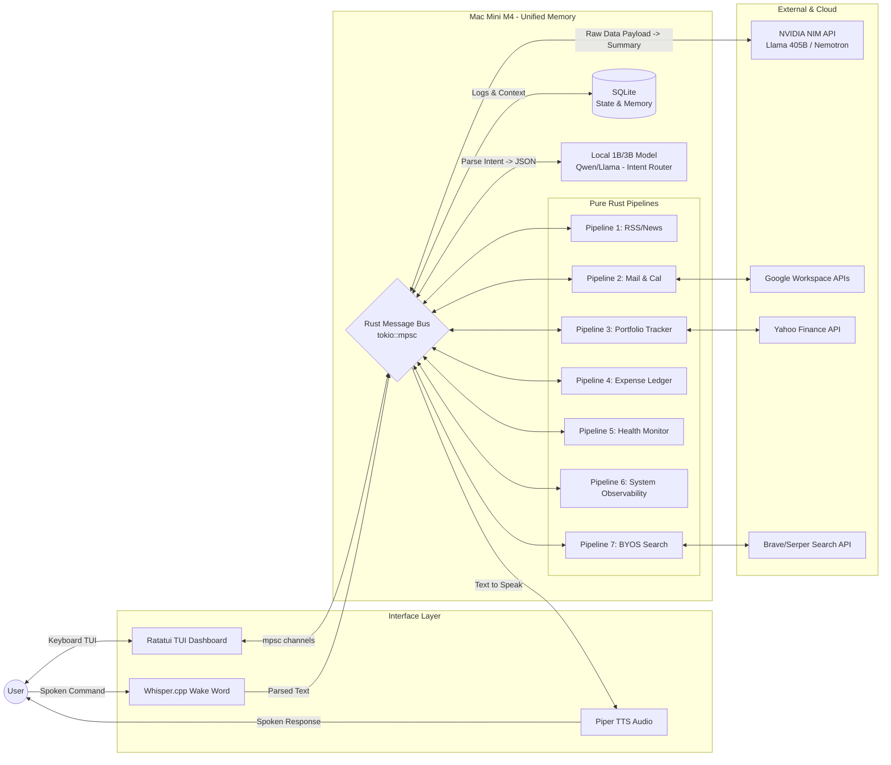

# Aura OS: Terminal-Based Deterministic Harness Design Document

## 1. High-Level Architecture Overview

Aura is a lightweight, high-performance, command-line AI operating system designed to run natively on Apple Silicon (Mac Mini M4, 16GB Unified Memory). The system abandons fragile "autonomous AI agents" and heavy web-based frontends in favor of an **Event-Driven Deterministic Harness** wrapped in a blazingly fast Terminal UI (TUI).

It utilizes the **"Cognitive Sandwich"** pattern: AI is strictly used at the boundaries (translating human input to JSON, and raw data to human summaries), while the core execution is handled by 100% pure, predictable Rust code.

### Core Stack
* **Frontend:** Terminal UI (TUI) via Rust crates `ratatui` and `crossterm`.
* **Backend:** Rust (`tokio` for async runtimes, pure API/scraper execution).
* **State Management:** Local SQLite database (`sqlx`).
* **Cognitive Layer:**
    * **Top Bread (Intent):** 1B/3B Local Model (e.g., Qwen 2.5 1.5B) via MLX/Ollama.
    * **Bottom Bread (Synthesis):** NVIDIA NIM API (e.g., Llama 3.1 405B or Nemotron) for massive context.

---

## 2. Visual Architecture Blueprint (Mermaid)



---

## 3. TUI Semantics & Layout Schema

The user interface operates inside the terminal (e.g., an iTerm2 drop-down visor). It uses `crossterm` for non-blocking input and `ratatui` for an information-dense, `htop`/`k9s`-style dashboard.

### 3.1 Boot Sequence (`neofetch` Style)
Displayed for 2 seconds upon binary execution to verify system integrity before loading the main dashboard.
```text
       /\          OS: Aura Harness v1.0
      /  \         Host: Mac Mini (M4) / 16GB Unified
     /____\        Kernel: Rust + tokio (v1.36)
    /      \       Uptime: 0 days, 00:00:04
   /        \      
                   Router: Qwen 2.5 1.5B (Local) [ONLINE]
                   Synth : NVIDIA NIM API        [ONLINE]
```

### 3.2 Main Interactive Loop (`k9s` Style)
A fully reactive dashboard. The UI thread runs independently of the `tokio` background workers, ensuring zero terminal freezing during execution.

```text
[1] Main  [2] Pipelines  [3] Network  [4] Logs                    [ Aura OS ]

CPU [||||||||..........]  32%  |  ROUTER [Qwen 1.5B]   : IDLE
RAM [|||||||||||||.....]  12G  |  SYNTH  [NVIDIA NIM]  : 0 tk/s
Q   [|.................]   1   |  PORTFOLIO (NIFTY 50) : WATCHING

────────────────────────────────────────────────────────────────────────────
DAEMONS (Active Pipelines)                                [ ? Help ] [ q Quit ]
NAME           STATUS       LAST EVENT                LATENCY   CPU%   MEM
[+] Portfolio  Watching     Nifty 50: K-Div Setup     12ms      0.1    12M
[+] RSS_Scrape Sleeping     Fetched 12 articles       --        0.0     8M
[+] Health_Mon Idle         --                        --        0.0     4M
[-] Deep_Rsch  EXECUTING    Parsing HTML DOM...       840ms     14.2   45M
────────────────────────────────────────────────────────────────────────────
> :tell portfolio to run a full analysis on current index
[ROUTER] Intent identified -> TARGET: Portfolio, ACTION: Full Analysis
[PORTFL] Polling Yahoo Finance API...
[SYNTH]  NVIDIA API generating summary...
```

---

## 4. The Cognitive Sandwich Architecture (Low-Level)

Aura relies on multi-threaded `tokio::mpsc` channels. There are zero LLM "tool calls." AI only translates state.

### Stage 1: The Top Bread (Intent & Extraction)
1. **User Input:** Raw text is captured via the TUI command bar.
2. **Classification:** Text is piped to the Local 1B model. 
3. **JSON Handoff:** The model translates human intent into strict JSON (e.g., `{"event": "EXECUTE_PORTFOLIO_CHECK", "target": "NIFTY_50"}`) and immediately unloads.
4. **Dispatch:** Aura Core routes the JSON to the target Pipeline's Input Queue.

### Stage 2: The Meat (Deterministic Execution)
1. **Pure Code Trigger:** The Rust pipeline sees the event.
2. **Zero-AI Execution:** Rust deterministically hits APIs, scrapes HTML, or queries databases.
3. **Raw Data Aggregation:** Rust compiles all fetched data into a massive, unformatted text string.
4. **Output Queue:** The raw data is pushed to the pipeline's Output Queue.

### Stage 3: The Bottom Bread (Synthesis & Formatting)
1. **Routing:** Aura Core detects raw data in an Output Queue.
2. **Synthesis:** Pushed to NVIDIA NIM API (or Local LLM for small payloads) to convert raw data into a human-readable summary.
3. **Response:** The summary is printed to the TUI log buffer and spoken via TTS.

---

## 5. Pure Rust Pipeline Definitions

These are strict, hardcoded state machines running as background `tokio` tasks.

* **Pipeline 1: RSS Gatherer**
  * *Execution:* `reqwest` fetches XML/HTML -> `scraper` parses text.
* **Pipeline 2: Calendar & Mail**
  * *Execution:* Authenticates via Google OAuth -> Pulls unread threads via IMAP/REST.
* **Pipeline 3: Portfolio Swing Tracker**
  * *Constraint:* Hardcoded to reject scalping/minute-data. Strictly evaluates swing trading signals.
  * *Execution:* Polls `yahoo_finance_api` for index data -> Calculates indicators (e.g., Knoxville Divergence) on daily/weekly timeframes -> Generates binary signal (True/False).
* **Pipeline 4: Finance Ledger**
  * *Execution:* Parses specific bank email senders via regex -> Writes to local SQLite.
* **Pipeline 5: Health Monitor**
  * *Execution:* Cron job -> Triggers UI prompt for manual entry -> Updates SQLite.
* **Pipeline 6: System Observability**
  * *Execution:* Reads macOS `sysinfo` -> Updates TUI header -> Issues SIGKILL to local Ollama instance if RAM exceeds bounds.
* **Pipeline 7: BYOS Deep Research**
  * *Execution:* Receives query -> Hits Brave/Serper API -> Rust HTTP client extracts paragraph text from resulting URLs.

---

## 6. Implementation Strategy

* **Phase 1: TUI & Boilerplate:** Build the `ratatui` UI loop, the `crossterm` input handler, and the `tokio::mpsc` message bus. Establish the split-pane dashboard.
* **Phase 2: Intent Layer:** Integrate the local Ollama REST call to route terminal inputs into strict JSON outputs.
* **Phase 3: Core Pipelines:** Build the pure-Rust API integrations (starting with Pipeline 6 for system metrics and Pipeline 3 for Portfolio).
* **Phase 4: Synthesis Layer:** Wire the Pipeline Output Queues to the NVIDIA NIM API for final summarization formatting.